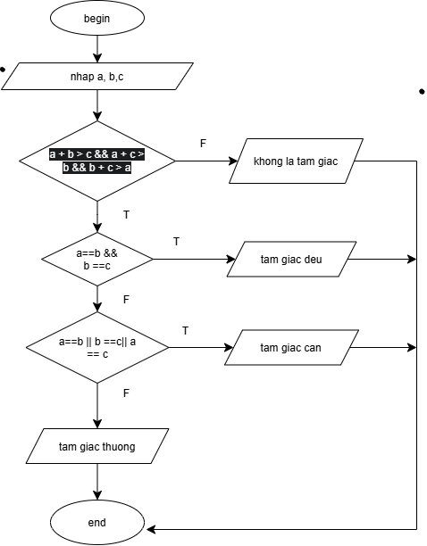

input: nhập a, b, c
output: trả về loại tam giác hoặc thông báo không là tam giác
method:
- nếu tổng 2 canh tam giác lớn hơn cạnh còn lại thì kiểm tra loại tam giác:
- nếu 3 cạnh tam giác bằng nhau thì trả về " tam giác đều"
- nếu 2 trong 3 cạnh tam giác bằng nhau thì trả về "tam giác cân"
- nếu không thỏa mãn thì trả về " tam giác thường"
- nếu không thì trả về " không là tam giác"
  
